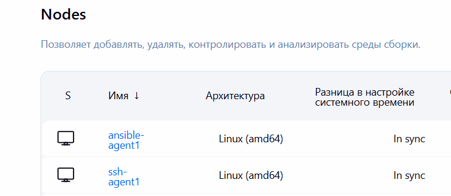
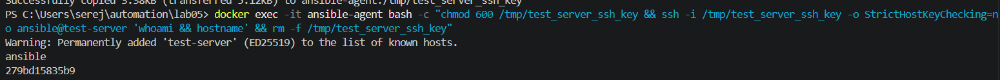
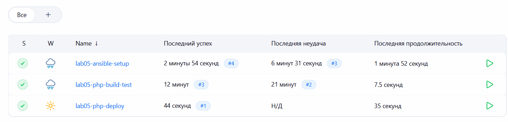
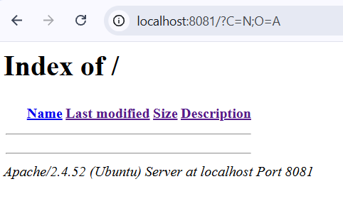

# Отчёт по лабораторной работе №5: Автоматизация настройки сервера и деплоя с помощью Ansible и Jenkins

## 1. Описание проекта

В рамках лабораторной работы №5 реализована многоконтейнерная инфраструктура на базе **Docker Compose** для автоматизации сборки, тестирования PHP-приложения, настройки тестового сервера и развёртывания проекта.

Инфраструктура включает четыре сервиса в единой сети `jenkins-network`:
- **`jenkins-controller`** — контроллер Jenkins LTS для управления пайплайнами, узлами и учётными данными;
- **`ssh-agent`** (`Dockerfile.ssh_agent`) — SSH-агент с установленными `php-cli`, `php-sqlite3` и инструментами сборки для запуска тестов PHP-проекта;
- **`ansible-agent`** (`Dockerfile.ansible_agent`) — агент на базе Ubuntu с установленным Ansible, SSH-сервером и Java для выполнения плейбуков и задач развёртывания;
- **`test-server`** (`Dockerfile.test_server`) — целевой тестовый сервер на базе Ubuntu с настроенным SSH-доступом для пользователя `ansible` и правами `sudo` (`NOPASSWD`), на который Ansible устанавливает Apache2 и PHP и выкладывает веб-приложение.

## 2. Настройка Jenkins Controller

1. В файле `compose.yaml` описан сервис `jenkins-controller` на базе образа `jenkins/jenkins:lts` с пробросом портов `8080:8080` и `50000:50000` и томом `jenkins_home`.
2. Контейнер запущен через `docker compose up -d --build`, после чего выполнена первичная инициализация Jenkins по адресу `http://localhost:8080`.
3. Через **Manage Jenkins → Plugins** установлены плагины **SSH Agent**, **GitHub Integration**, **Docker** и **Docker Pipeline**.
4. В **Manage Jenkins → Credentials** добавлены ключи SSH (`SSH Username with private key`) для подключения к агентам и к тестовому серверу.

## 3. Настройка SSH-агента и Ansible-агента

1. **SSH-агент для PHP:** подготовлен `Dockerfile.ssh_agent` с установкой `php-cli`, `php-sqlite3`, `git` и необходимых расширений; сервис `ssh-agent` добавлен в `compose.yaml` в сеть `jenkins-network` с передачей публичного ключа через `JENKINS_AGENT_SSH_PUBKEY`, приватный ключ добавлен в Jenkins Credentials (`jenkins`), а в **Manage Jenkins → Nodes** создан постоянный узел `ssh-agent1` (`Host: ssh-agent`, `Remote root directory: /home/jenkins/agent`, `Labels: php-agent`, метод запуска *Launch agents via SSH*).

2. **Ansible-агент на базе Ubuntu:** подготовлен `Dockerfile.ansible_agent` (`DEBIAN_FRONTEND=noninteractive`, `TZ=Europe/Chisinau`) с установкой `openssh-server`, `openssh-client`, `default-jre-headless`, `ansible`, `python3-pip` и `git`, добавлен сервис `ansible-agent` в `compose.yaml`, создан пользователь `jenkins` с настройкой доступа по ключу `ANSIBLE_AGENT_SSH_PUBKEY`, ключ внесён в Jenkins Credentials и подключён постоянный узел `ansible-agent1` (`Host: ansible-agent`, `Remote root directory: /home/jenkins`, `Labels: ansible-agent`).

3. **Ключ для подключения к тестовому серверу:** сгенерирована пара ключей `test_server_ssh_key` для работы Ansible от имени пользователя `ansible` с `test-server`, а приватный ключ сохранён в Jenkins Credentials (`test-server-ssh-key`) для безопасной передачи в пайплайны через `withCredentials`.

## 4. Создание тестового сервера

1. Создан файл `Dockerfile.test_server` на базе Ubuntu с установкой `openssh-server` и `sudo`.

2. Создан пользователь `ansible`, настроен беспарольный `sudo` (`NOPASSWD:ALL`), добавлен открытый ключ `TEST_SERVER_ANSIBLE_PUBKEY` в `/home/ansible/.ssh/authorized_keys` с корректными правами (`700` на `.ssh`, `600` на `authorized_keys`) и запущен демон `sshd`.
3. Сервис `test-server` добавлен в `compose.yaml` с пробросом HTTP-порта на хост и проверено SSH-подключение от `ansible-agent` под пользователем `ansible`.

## 5. Описание Ansible Playbook и его задач

Инвентарь описан в `lab05/ansible/hosts.ini` (группа `[test_servers]`, хост `test-server`, пользователь `ansible`).

Плейбук `lab05/ansible/setup_test_server.yml` выполняет следующие задачи с повышением привилегий (`become: true`):
- **Обновление кэша пакетов (`ansible.builtin.apt`)** — обновляет индекс репозиториев APT.

- **Установка Apache2 и PHP (`ansible.builtin.apt`)** — устанавливает `apache2`, `php`, `libapache2-mod-php`, `php-cli`, `php-sqlite3`, `php-mbstring`, `php-xml`.
- **Подготовка каталога приложения (`ansible.builtin.file`)** — создаёт директорию `DocumentRoot` с владельцем `www-data` и правами `0755`.
- **Настройка VirtualHost Apache2 (`ansible.builtin.copy`)** — создаёт конфигурацию виртуального хоста на порт `80` с указанием `DocumentRoot` и прав доступа `<Directory>`, отключает стандартный сайт `000-default.conf`, активирует конфигурацию приложения и перезагружает `apache2` через `handlers`.

## 6. Пайплайны Jenkins

В каталоге `lab05/pipelines/` реализованы три декларативных пайплайна:

1. **`php_build_and_test_pipeline.groovy`** (агент `php-agent`):
   - клонирует репозиторий с PHP-проектом;

   - устанавливает зависимости через Composer (при наличии `composer.json`);
   - запускает модульные тесты (PHPUnit или тестовый скрипт проекта) и выводит статус прохождения тестов.

2. **`ansible_setup_pipeline.groovy`** (агент `ansible-agent`):
   - клонирует репозиторий с плейбуком и инвентарём;

   - прокидывает приватный ключ через `withCredentials` и запускает `ansible-playbook` для настройки `test-server`.
3. **`php_deploy_pipeline.groovy`** (агент `ansible-agent`):
   - клонирует репозитории с конфигурацией деплоя и исходным кодом PHP-проекта;

   - копирует файлы приложения на `test-server` в каталог веб-сервера, выставляет права `www-data` и перезагружает Apache2.

После выполнения пайплайнов работоспособность приложения проверена в браузере по адресу тестового сервера.

---

## 7. Ответы на вопросы

### Какие преимущества даёт использование Ansible для настройки серверов?
- **Отсутствие агентов на целевых хостах:** для управления достаточно SSH-доступа и установленного Python на целевой машине.
- **Идемпотентность:** повторный запуск плейбука приводит систему в заданное состояние без дублирования настроек и лишних изменений, если состояние уже достигнуто.
- **Читаемость и версионирование:** конфигурация описывается в декларативном формате YAML и удобно хранится в Git вместе с историей изменений.
- **Масштабируемость:** один плейбук можно применить сразу к группе серверов из инвентаря.

### Какие ещё модули Ansible существуют для управления конфигурацией?
- **`ansible.builtin.template`** — генерация конфигурационных файлов из шаблонов Jinja2 с подстановкой переменных.
- **`ansible.builtin.user` / `ansible.builtin.group`** — управление пользователями и группами в системе.
- **`ansible.builtin.service` / `ansible.builtin.systemd`** — управление службами (запуск, остановка, перезагрузка, автозагрузка).
- **`ansible.builtin.lineinfile` / `ansible.builtin.blockinfile`** — точечное добавление или изменение строк и блоков в конфигурационных файлах.
- **`ansible.builtin.file`** — создание файлов, каталогов, ссылок, управление правами и владельцами.

### С какими проблемами вы столкнулись при создании playbook и как их решили?
- **Интерактивные запросы при установке пакетов в контейнере:** при установке пакетов с зависимостями вроде `tzdata` сборка могла зависать в ожидании ввода — проблема решена передачей `DEBIAN_FRONTEND=noninteractive` и часового пояса `TZ=Europe/Chisinau`.
- **Ошибка группы/прав при создании пользователя и каталогов:** несоответствие группы при `chown` и настройке прав на `.ssh/authorized_keys` устранено проверкой создания пользователя, группы и прав доступа (`700` / `600` / `www-data`).
- **Настройка VirtualHost и пути к приложению:** потребовалось согласовать `DocumentRoot` в конфигурации Apache2 с реальным путём развёртывания PHP-файлов и перезагрузкой службы `apache2` через `handlers`.